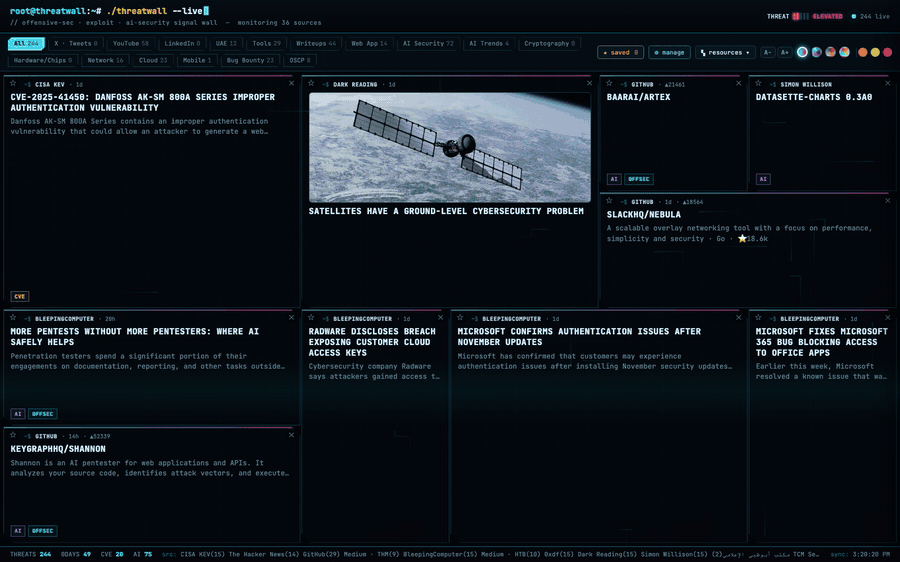
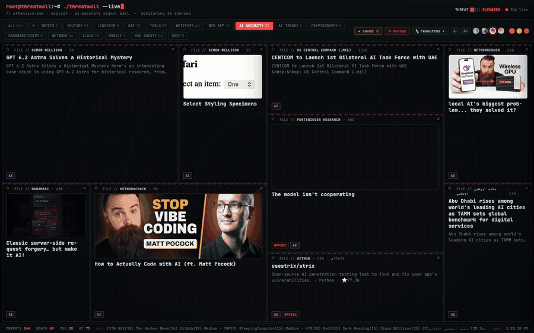
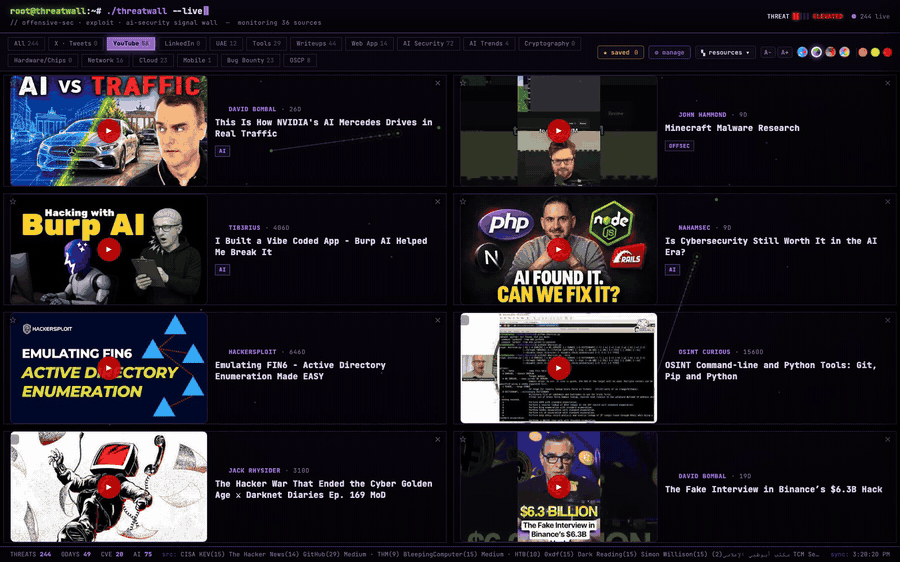

# 🛡️ ThreatWall — Live Threat & News Wall

A dashboard of news related to **offensive-security & AI-security**. It aggregates 30+ live sources: security news, exploit research, CVEs actively exploited in the wild, writeups, YouTube, X/Twitter, GitHub tools, and more — into a single dashboard.

> `root@offsec:~# ./threatwall --live`










---

## 🚀 Getting Started

### Prerequisites
- [Bun](https://bun.sh) `>= 1.0` (`curl -fsSL https://bun.sh/install | bash`)

### Run it

```bash
git clone https://github.com/classic-r3d/threatwall.git ThreatWall
cd ThreatWall
bun start
```

Then open **http://localhost:8090**.

The server pulls all sources on boot (a few seconds), then re-pulls every **3 hours** 

### Scripts

| Command | What it does |
|---|---|
| `bun start` | Run the server in the foreground (`Ctrl+C` to stop) |
| `bun run start:bg` | Run in the background, logging to `server.log` |
| `bun run stop` | Kill whatever is on the port |
| `bun run restart` | Stop + start |
| `bun run seed-yt` | Slowly (re)fill the YouTube cache (see below) |

Change the port with an env var:

```bash
PORT=9000 bun start
```

---

## 🔁 Development

The server serves `public/index.html` **fresh on every request**, so:

- **Editing `public/index.html`** (layout / CSS / client JS) → just **reload the browser**, no restart.
- **Editing `server.ts`, `sources.ts`, or `aggregate.ts`** (backend / data logic) → **restart** (`bun run restart`).

---

## 🗂️ Project Structure

```
ThreatWall/
├── server.ts            # Bun HTTP server: serves the UI + /api/items, refreshes on a timer
├── aggregate.ts         # merges all sources, scores + categorizes items, per-source caching
├── sources.ts           # every source fetcher (RSS/JSON) + the zero-dep feed parser
├── config.ts            # tab/resource config: built-in tabs, custom tabs, persistence
├── verify.ts            # validates user-added feed URLs (with SSRF guards)
├── public/
│   └── index.html       # the entire single-page UI (HTML + CSS + JS, self-contained)
├── scripts/
│   └── seed-yt.ts       # one-off: slowly seed the YouTube cache
├── docs/                # README screenshots
├── yt-cache.json        # generated: per-channel YouTube cache (persists across restarts)
└── package.json
```

### API

| Route | Description |
|---|---|
| `GET /` | The dashboard UI |
| `GET /api/items` | All items with `sources`, `categories`, `fetchedAt` |
| `GET /api/health` | `{ status, items, sources, fetchedAt }` |

---

## 📡 Data Sources

All free & unauthenticated:

- **News / research** — The Hacker News, BleepingComputer, Krebs on Security, Dark Reading, PortSwigger Research, Google Project Zero, Simon Willison, arXiv `cs.CR`
- **Aggregators / forums** — Hacker News (Algolia), r/netsec, r/redteamsec
- **CVEs** — CISA Known Exploited Vulnerabilities (KEV)
- **Tools** — GitHub Search API (ranked by stars = real virality)
- **Writeups** — 0xdf, Medium (`hackthebox`, `tryhackme` tags), InfoSec Write-ups
- **YouTube** — 14 offensive-sec / AI-sec channels (LiveOverflow, IppSec, John Hammond, NahamSec, David Bombal, TCM Security, NetworkChuck, Cybernews, zSecurity, Tyler Ramsbey, Jack Rhysider, Tib3rius, HackerSploit, OSINT Curious)
- **X / Twitter** — curated security & AI accounts via Nitter (best-effort)
- **LinkedIn** — security posts indexed via Google News
- **Podcast** — Darknet Diaries

---

## 🎬 YouTube cache

YouTube aggressively blocks datacenter IPs from its RSS feeds. To stay populated the app:

1. Fetches channels **gently** (2 at a time) only every 3 hours.
2. Caches each channel's videos **per-channel to `yt-cache.json`**, so successful channels persist and accumulate — the tab never re-empties, even across restarts.

If the tab thins out, reseed it slowly (stop the server first so it doesn't overwrite mid-seed):

```bash
bun run stop
bun run seed-yt      # fetches each channel with long gaps + retries (~2–3 min)
bun start
```

---

## ⚙️ Configuration

| What | Where |
|---|---|
| Port | `PORT` env var (default `8090`) |
| Refresh interval | `REFRESH_MS` in `server.ts` (default 3h) |
| Sources & accounts | the fetcher list + `X_ACCOUNTS` / `YT` arrays in `sources.ts` |
| Filter keywords | `CAT_RE` in `aggregate.ts` |
| Scoring weights | `score()` in `aggregate.ts` |


